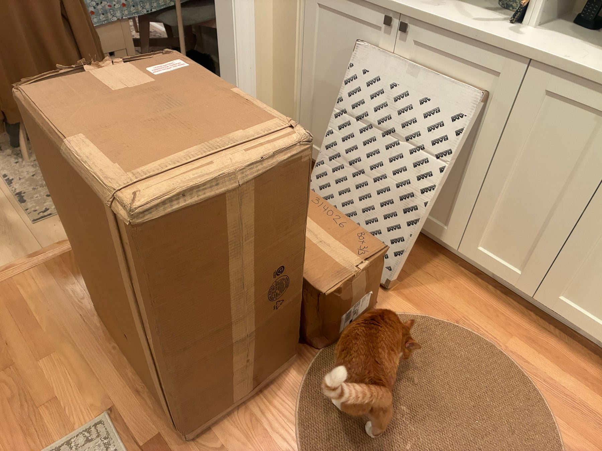
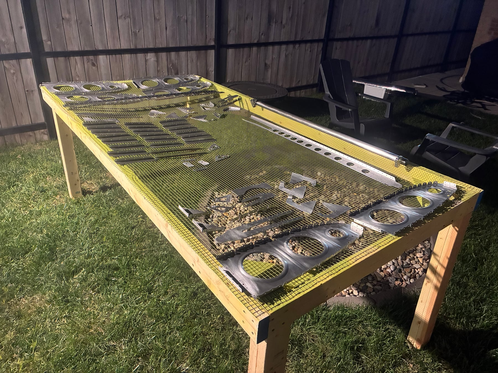
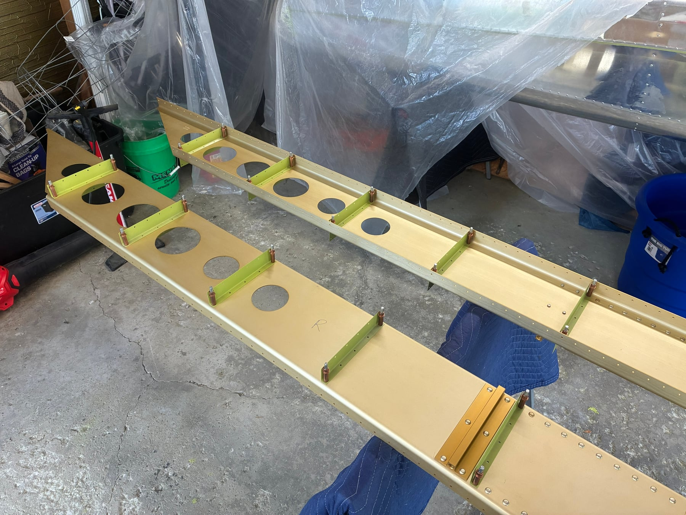
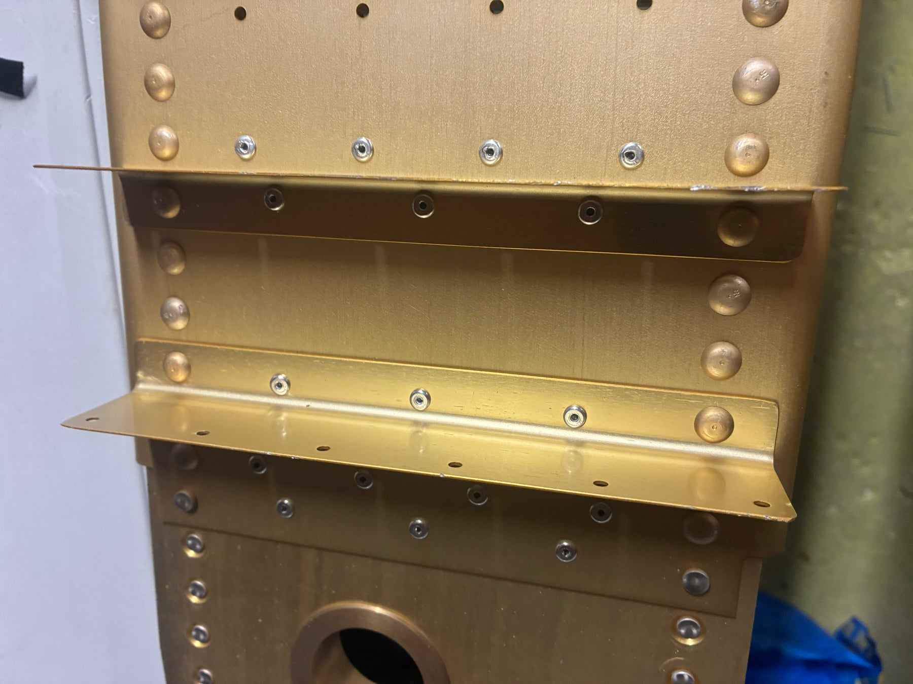
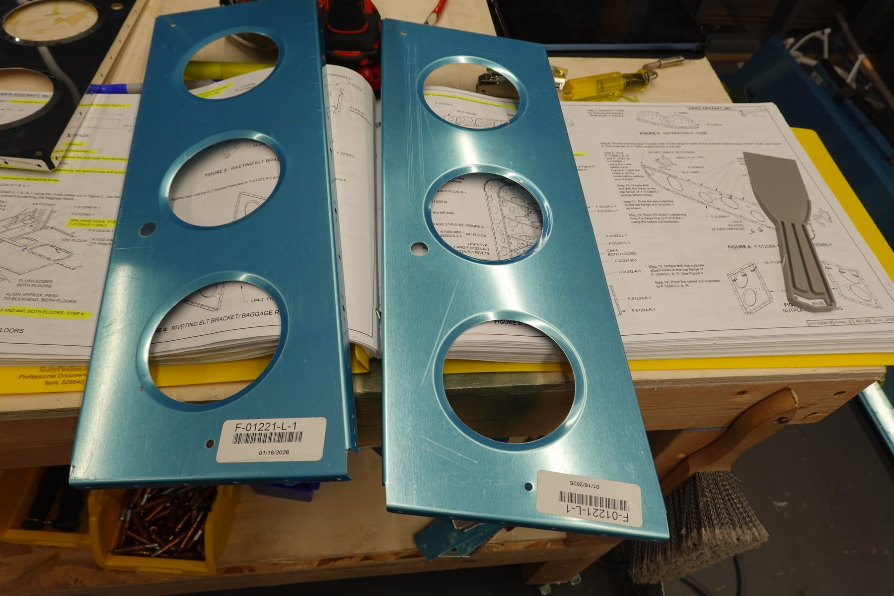
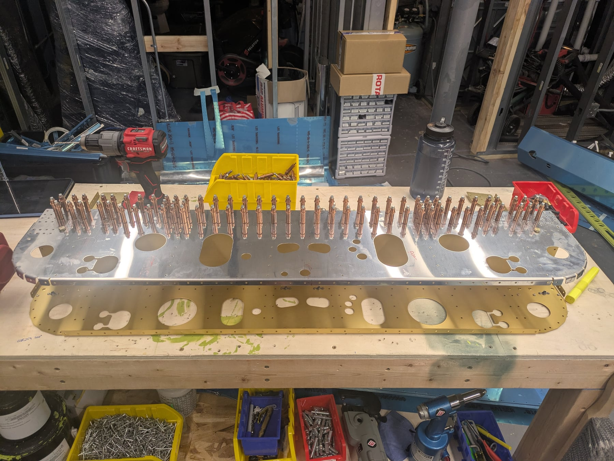
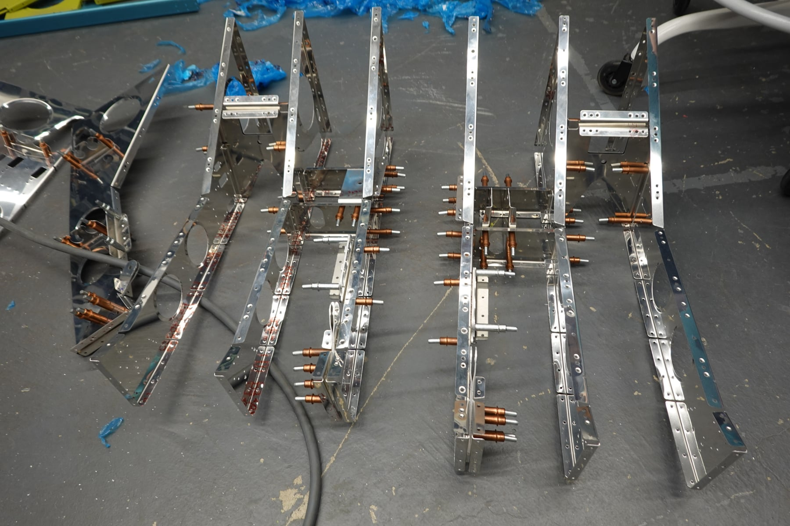

I said I wasn't going to do an update again until the ribs were done. They
aren't, but Shelby has put in over 40 hours of deburring since the last
update and I've started on the fuselage now that the bottom skin arrived
from backorder. We've primed two sets of ribs so far and I've made progress
through most of the Center Section Bulkhead and Mid-Fuse Ribs & Bottom
Skins sections. I've started deburring the fuselage pieces for priming and
assembly, hopefully later this week.

## Thanks to Brantel

Big thanks to [Brantel](https://blog.n912bc.us/). I messaged him a few
months ago about fuselage painting and he gave some tips, one of which was
to prime with something other than the ZC Green so that any scratches don't
show up as green. So the entire fuselage will be primed in Charcoal Gray
instead. I am not going to take his advice of final painting everything
before assembly. My plan is to finish the fuselage and then take it to a
local body shop for painting of the interior. That sounds like a massive
project, but I'll continue my philosophy of "one bite of the elephant" and
think about that when the time comes.

Also thanks to [his very thorough blog](https://blog.n912bc.us/). It's a
great reference for when I want to verify that I understand a part of the
KAI correctly. Invaluable resource for sure.

## October hours

We've done a lot of hours in October, I think our busiest month yet. 56.9
combined hours so far this month and 325 total on the project, and there's
momentum building. We keep telling people we want to have the plane flying
by Oshkosh next year (already an extension from the 12 month timeline we
originally gave ourselves) but I think 18 months isn't bad from no airplane
experience to airplane, pilot licenses, and LSRM.

## Out of room

We've run out of room. For everything. Between the airplane, the stalled
basement remodel that's resuming soon, and our exchange student, we have no
space left for the assembled airplane and the basement needs to be cleared
out. So we rented a storage unit and we're going to store (insured)
airplane parts in there. Just airframe pieces like the tailcone and
stabilator. We rented a U-Haul (first of multiple throughout this process,
the next one will probably be to bring the fuselage to a body shop) and
moved everything this morning.

## Everything has arrived

Everything has arrived at this point. The avionics (G3X unfortunately, but
we'll make it work) were delivered a few weeks ago. Definitely the most
expensive UPS package I've ever received. The shipping was over $1,000
which surprised me, but I'm guessing it was mostly insurance. We have all
of the backordered pieces as well, so at this point it's on us to assemble
everything.

## Replacement parts

A couple small things. A rear spar of a wing was stepped on (not placing
blame here...). It could probably bend out, but for a wing spar I'm taking
absolutely zero chances, so there's $78. Also when building the fuselage I
noticed that we got two of one piece rather than one of one and one of
another. They were only one number off so it's an easy mistake to make.
I'll probably just pay the $28 for the correct one rather than wait a few
extra days for Vans to correct it, since it would be a blocker in the
fuselage build.

## Open questions with Vans

We sent Vans two questions and are waiting on follow ups. I have
preliminary information from the VAF forum, but I do prefer to have a
statement from the manufacturer for my official build log. One was
regarding the wedge tool. It was causing a bit of distortion in the head of
the rivet. I bought ATS's angle puller instead and will be using that going
forward. The second was regarding nutplates and the CCR rivets. No matter
what I do I can't get them to be snug and they wiggle quite a bit. I know
this is normal, but was hoping for some tips there.

## About this log

I'll attach a bunch of pictures with captions as well. Unlike Brantel I'm
not super detailed on the build process itself. There are better resources
like his blog for a step by step breakdown. I guess I'm considering this
build log to be the more logistical side of building a plane, and I hope
the detailed breakdown of the process, costs, tool list, and everything
else helps people. Oh yeah, we bought a few more tools as well. I feel like
there's always tools to buy.

## Photos

{section=avionics}

{section=wings}

{section=wings}

{section=wings}

{section=wings}

